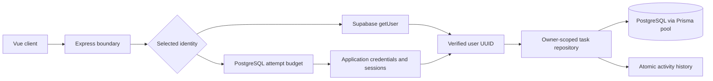
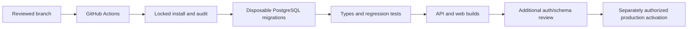

# Architecture

Single npm-workspace repository; no microservices.
- `apps/web`: Vue 3 + Vite client.
- `apps/api`: Express routes, Zod validation, Prisma persistence.
- `packages/shared`: shared contracts only where needed.

Task model: ID, title, optional description, status (NEW/IN_PROGRESS/WAITING/COMPLETED), priority (LOW/NORMAL/HIGH/URGENT), optional due date and origin, demo marker, timestamps. TaskActivity is related to Task and cascades on deletion.

API: GET /health; GET/POST /api/v1/tasks; GET/PATCH/DELETE /api/v1/tasks/:id. List supports bounded page/limit, status/priority filters, owner-scoped search and deterministic sorts. GET /api/v1/tasks/summary returns owner-scoped counts independently of loaded pages. GET /ready checks database reachability separately from liveness.

PostgreSQL is persistent storage; Prisma manages schema and migrations. Each task is scoped to the verified user UUID from the selected authentication mode; legacy rows with no owner are quarantined. Email providers and AI remain optional adapters outside the core task domain.

Route tests use an in-memory repository. CI generates Prisma Client, applies committed migrations to an ephemeral PostgreSQL 17 service, type-checks, runs tests, and builds both applications.

Task history records each changed field independently. The web client also recognizes the legacy UPDATED event type for records created before field-level history was introduced. Status and priority entries include the previous and new human-readable values; descriptions and origins are recorded as change events without copying their contents into the audit message. No-op updates do not create activity entries.

Task mutations own their history persistence. Creation uses a nested atomic write; updates read the prior task, persist fields and append history in one serializable Prisma transaction, retrying serialization conflicts up to three total attempts. HTTP routes never append audit events separately. PostgreSQL integration tests cover rollback and concurrent field updates when TEST_DATABASE_URL is configured.

Authentication is a request boundary: the API verifies Bearer tokens with Supabase Auth getUser, then creates a request-scoped repository sharing a single Prisma connection pool. Every task and activity query includes ownership. No user-supplied owner field or user_metadata participates in authorization. The browser stores its session in sessionStorage and sends Bearer tokens to the same-origin API. App.vue gates and unmounts TaskDashboard.vue on account changes/logout.

RLS is enabled without client policies on Task, TaskActivity and migration history, denying direct Data API access. The trusted Prisma connection must use a server-only role that can bypass RLS; it must never be exposed to the browser. Application-level ownership checks remain mandatory for that role.

Independent authentication is optional: AUTH_MODE=neon uses application-managed
AuthUser/AuthSession tables, salted scrypt hashes and opaque revocable sessions.
It is not the managed Neon Auth product. The matching browser mode uses the
same-origin auth API; only the selected identity source controls the dashboard.
Logout removes local credentials and private views before awaiting revocation;
a network failure is reported without promising server-side revocation.
Source implementation, PR integration and hosted activation are tracked separately
in AUTH_MIGRATION_STATUS.md.

## Shared account budgets (proposed in PR #24)

AuthAttempt is a server-only, RLS-enabled PostgreSQL table with a derived account
key, bounded counter and expiry index. An atomic INSERT ... ON CONFLICT update
admits ten requests per account/window across instances. Database time determines
expiration. A missing migration/store failure denies authentication with 503.
No raw email, password, IP or bearer is stored in this table. Hashes of known
emails remain personal data and are not anonymization.

This is a layered account throttle, not complete platform rate limiting or DDoS
protection. See SECURITY.md and adr/0001-shared-account-budgets.md.

Browser restoration keeps a token during transient network/provider failures,
but never renders private views without successful identity restoration.
A definitive 401 clears the independent token. Revocation/logout semantics
remain documented in SECURITY.md; no provider cutover is implied.
